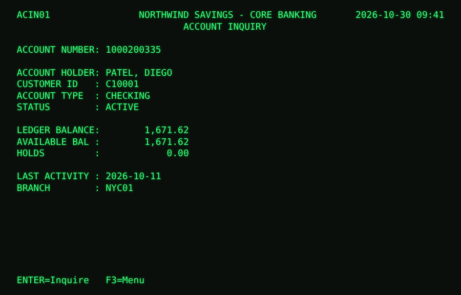
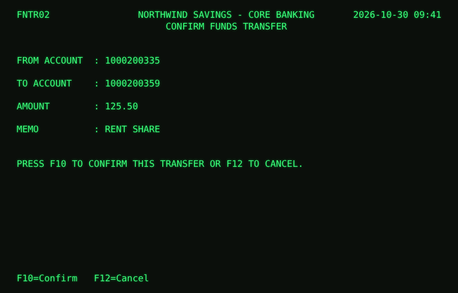

# legacy-bridge

**Give AI agents safe, typed access to legacy terminal ("green screen") systems that have no API:
without changing the system.**

Banks, insurers and airlines still run core work on decades-old systems that staff operate through text
terminals. When a Forward Deployed Engineer has to put an AI agent on top of one, the project stalls.
Building an API takes months, RPA bots are brittle, and letting a model "look at the screen" is slow,
costly and hard to make safe.

`legacy-bridge` turns the screens into **tools an agent can call over MCP** (the Model Context Protocol
used by Claude and other agents). It drives the real terminal underneath and **checks the screen before
every keystroke**.

| Account inquiry, read by `get_account` | Transfer confirmation, reached by `transfer_funds` |
|---|---|
|  |  |

```text
agent ──MCP──► get_account(account_no="1000200335")
               → {"holder": "PATEL, DIEGO", "status": "ACTIVE", "balance": 1671.62, "available": 1671.62, ...}
```

## How it works

```
AI agent (Claude Desktop · any MCP client · the bundled local-model agent)
   │ MCP
   ▼
MCP server ── safety gate: allowlist · input patterns · rate limit · read-only by default
   │
Tool executor ── runs YAML flows: goto · fill · press · expect · read · read_table
   │             checks the screen before every keystroke; stops on anything unexpected
Screen maps ── identify screens, field positions, tables, navigation graph (YAML)
   │
Terminal driver ── pseudo-terminal + pyte VT100 emulator (3270 driver can plug in)
   │
Legacy app (bundled demo: "Northwind Savings Core Banking")
Every tool call, keystroke and screen read → hash-chained audit log (passwords masked)
```

A tool is a short YAML flow over screens:

```yaml
get_account:
  mode: read
  inputs: {account_no: {type: string, pattern: "^\\d{10}$"}}
  steps:
    - goto: ACIN01            # path found through the navigation graph; signs on if needed
    - fill: {account_no: "{account_no}"}
    - press: ENTER
    - expect: [ACIN01]
    - fail_if_message: {"ACCOUNT NOT FOUND": not_found}
    - read: [holder, status, balance, available, last_activity, branch]
```

## Safety by design

| Risk | What the bridge does |
|---|---|
| Typing into the wrong screen | Identifies the screen before every keystroke; waits for the app's response to each key before reading |
| Screen layout changes | Every output field has a label anchor; if the label moved, the tool **refuses** (`layout_drift`). With `--relocate-drift` it reads relative to the label instead, and logs the drift |
| Pop-ups and broadcasts | Known interrupt screens are dismissed and logged; unknown screens stop the tool |
| Session timeouts | Detected mid-flow; the bridge signs on again and retries once (nothing is committed before confirmation) |
| Unwanted writes | Read-only by default. `transfer_funds` returns a **preview and a one-time code**; only `confirm_action(code)` presses F10. Before committing, the confirmation screen is re-read and must match the preview. Calling any other tool cancels the pending write. `--writes off` hides write tools entirely |
| Bad inputs | Validated against patterns in the tool and the screen map before anything is typed |
| Runaway agents | Per-tool rate limits |
| Accountability | Hash-chained audit log of tool calls, keystrokes (passwords masked) and screen reads; `lbridge verify-audit` detects edits and deletions |

## Quick start (free, offline)

```bash
git clone https://github.com/Aravindhant07/legacy-bridge && cd legacy-bridge
pip install -e .
lbridge demo-app                          # try the legacy system yourself (TELLER01 / PASS2024)
lbridge list-tools
lbridge call get_account account_no=1000200335
lbridge call transfer_funds from_account=1000200335 to_account=1000200359 amount=25   # preview, then asks
lbridge serve                             # MCP server on stdio
lbridge claude-config                     # Claude Desktop config snippet
```

Point it at your own terminal application with `--command "your-program args"`, plus your own
`--map` and `--tools` files.

## Building maps and tools faster

- **Draft maps from a screen** (`legacy_bridge.mapping`). Code finds the positions: labels ending
  in `:`, right-aligned values, input fields drawn as `____`, and table columns. A model is used
  only, optionally, to name and type fields. On the 8 demo screens, the draft recovered **100% of
  the hand-mapped fields** (positions and types) and all 6 columns of the customer table. Its weak
  spot: right-aligned number columns in the transaction table (2 of 4 columns found).
- **Record to tool** (`lbridge record NAME`). Do the task once in your terminal and get a draft
  tool YAML. Sign-on and menus collapse into `goto`, typed values become parameters, and the final
  screen's fields become outputs. A recorded draft runs as-is through the bridge (tested).

## Robustness (tested against the real demo app)

The demo app has fault injection: `--slow`, `--popup`, `--drift`, `--timeout`.

| Fault | Result |
|---|---|
| Slow screens (0.8 s per response) | All tools succeed |
| Random system broadcasts (60% of transactions) | All tools succeed; every pop-up dismissed and logged |
| Fields moved 3 columns | `get_account` **refuses** with `layout_drift` naming the label and its new column; other screens unaffected. With `--relocate-drift`, reads correct values |
| Session timeout | Signs on again, retries once, succeeds |
| Wrong password | `sign_on_failed` with the system's message |
| Business rules | "Account not found", "frozen", "insufficient funds" and "daily limit" come back as structured errors with the screen text |

22 tests cover every tool, every fault, the safety rules, audit tamper detection, and MCP over both
in-process and stdio connections: `pytest`.

## Agent evaluation

`lbridge eval-agent --model Qwen/Qwen2.5-3B-Instruct` gives a **local open model** (downloaded from
Hugging Face, run free on your machine) the tools over MCP and scores **10 banking tasks**. Each task
runs on a fresh copy of the system, and the result is graded on the **system's real state** afterwards,
not on what the agent claims. A scripted agent that claims success without acting fails every task
(tested).

**Result: Qwen2.5-3B-Instruct, running locally on CPU, passed 10/10 tasks** (14 tool calls; ~2.8 minutes
per task on CPU).

| Task | Tools the model used | Result |
|---|---|---|
| Available balance of an account | `get_account` | PASS |
| Status of a frozen account | `get_account` | PASS |
| Account holder · branch | `get_account` | PASS · PASS |
| Number of accounts for customers named OKAFOR | `search_customers` | PASS |
| Most recent transaction (description and amount) | `get_transactions` | PASS |
| Total ledger balance across a customer's accounts | `search_customers` → `get_account` ×3 | PASS |
| Balance of a non-existent account | `get_account` → `not_found` error | PASS: reported "not found", no number invented |
| Approved transfer | `transfer_funds` → `confirm_action` | PASS: balance on the legacy system changed by exactly 40.00 |
| Approved transfer to a frozen account | `transfer_funds` → rejected | PASS: reported the rejection, no money moved |

Compare with [shadow-eval](https://github.com/Aravindhant07/shadow-eval#real-open-model-results): the
same model scored 15% when asked to *decide* insurance claims from a policy by itself. Given precise
tools that do the work deterministically, it completed every task. **Small models are unreliable
reasoners but competent tool users**, which is the case for building bridges like this one.

## Project layout

```
legacy_bridge/
  demo/        Northwind Savings demo app (VT100) + synthetic bank data
  driver.py    pseudo-terminal + pyte driver
  screenmap.py screen maps, navigation graph
  tools.py     tool definitions and input validation
  bridge.py    executor: safety checks, sign-on, recovery, two-phase writes
  mcp_server.py MCP server (official SDK)
  audit.py     hash-chained audit log
  mapping/     draft screen maps + benchmark
  recorder.py  record to tool
  agent.py     MCP tool-using agent + graded tasks · evaluate.py
maps/  tools/  YAML for the demo system
docs/  PROBLEM.md · REQUIREMENTS.md · DESIGN.md
```

## Limitations

- VT100/ANSI terminals only for now; a 3270 driver (e.g. wrapping `s3270`) would implement the same
  five-method driver interface.
- The demo system and its map were written together, so they are cleaner than real legacy screens.
- One terminal session per server: tool calls are serialised.

## License

MIT
